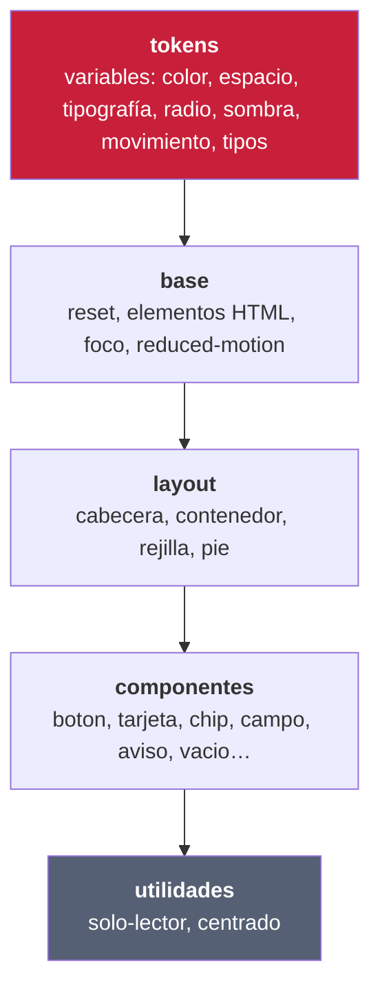
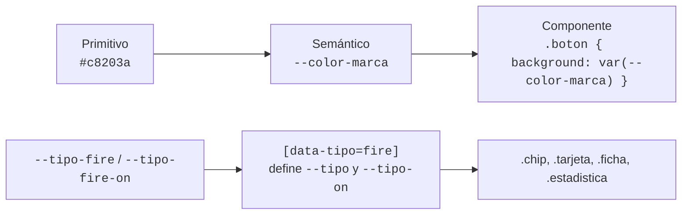
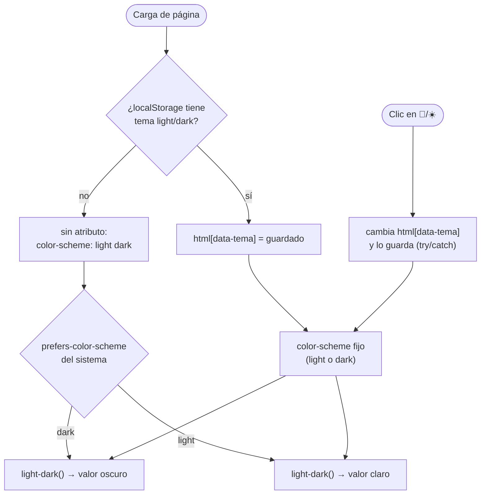
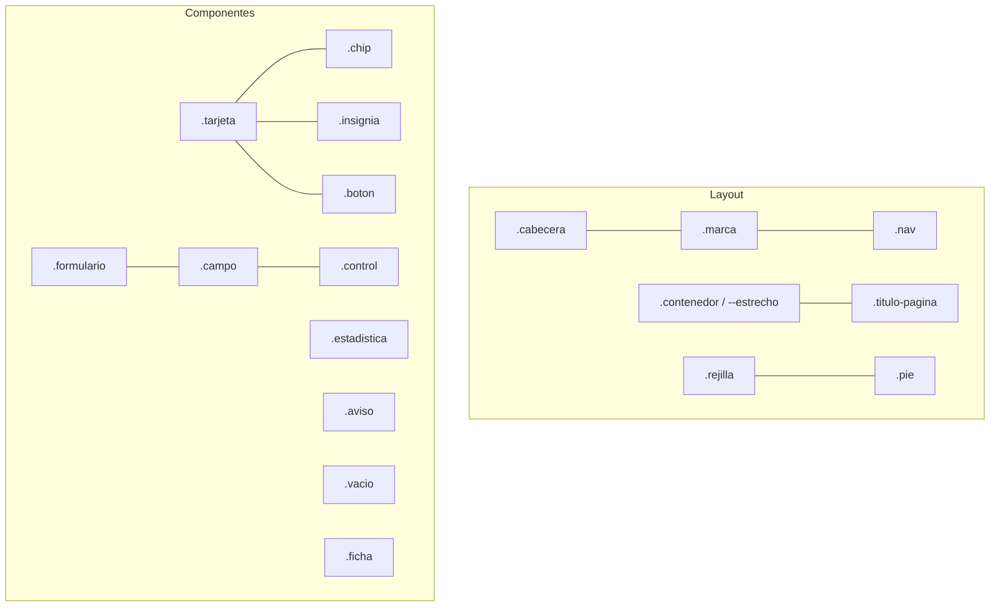

# DESIGN.md · Sistema de diseño de Pokédex DAW

Este documento es la **fuente de verdad del diseño** de la aplicación. Todo lo que aquí se describe
está implementado en [`web/css/style.css`](web/css/style.css) y se puede ver funcionando en la
[guía de estilos](web/guia-estilos.html) (`http://localhost:8080/guia-estilos.html`).

> **Regla de oro:** un componente **solo** usa tokens (`var(--…)`). Nunca colores, tamaños ni sombras
> escritos «a mano». Si falta un valor, se crea primero el token y después se usa.

## Índice

1. [Principios](#1-principios)
2. [Arquitectura del CSS](#2-arquitectura-del-css)
3. [Tokens](#3-tokens)
4. [Tema claro y oscuro](#4-tema-claro-y-oscuro)
5. [Componentes](#5-componentes)
6. [Convenciones de nombres](#6-convenciones-de-nombres)
7. [Accesibilidad](#7-accesibilidad)
8. [Responsive](#8-responsive)
9. [Cómo ampliar el sistema](#9-cómo-ampliar-el-sistema)

## 1. Principios

| Principio | Qué significa en este proyecto |
|---|---|
| **Funciona sin internet** | Fuente del sistema (`system-ui`), sin librerías ni CDN, imágenes locales. Es una actividad de clase. |
| **Tokens primero** | Cambiar la marca, el tema o la densidad se hace tocando tokens, no componentes. |
| **Accesible por defecto** | Contraste ≥ 4,5:1 medido, foco visible, navegación por teclado, `prefers-reduced-motion`. |
| **El tipo manda** | Cada Pokémon aporta su color de tipo (`data-tipo`); la interfaz lo hereda sin código extra. |
| **Simple de leer por el alumnado** | Sin frameworks ni preprocesadores: CSS nativo moderno (`@layer`, `light-dark()`, `color-mix()`). |

## 2. Arquitectura del CSS

Un único fichero ordenado en **capas** (`@layer`). El orden de las capas decide quién gana, no la
especificidad: así un componente nunca se «rompe» por un selector más largo.



Lo que **no** se puede hacer (aprendido depurando este proyecto): redefinir en una capa posterior una
variable que otra capa anterior ya fija por atributo. Por ejemplo, `.tarjeta { --tipo: … }` en
*componentes* ganaba a `[data-tipo="fire"]` en *tokens* y todas las tarjetas salían del color «normal».
Los componentes leen `var(--tipo, var(--tipo-normal))` y **no** declaran `--tipo`.

## 3. Tokens

Tres niveles: **primitivos** (valores crudos) → **semánticos** (para qué sirven) → **de componente**
(p. ej. `--tipo`). Los componentes solo usan los dos últimos.



### 3.1 Color semántico (claro | oscuro)

| Token | Claro | Oscuro | Uso |
|---|---|---|---|
| `--color-fondo` | `#f4f5f9` | `#11141c` | fondo de página |
| `--color-superficie` | `#ffffff` | `#1b202c` | tarjetas, formularios, campos |
| `--color-superficie-2` | `#eceef4` | `#232a39` | insignias, hover secundario |
| `--color-borde` | `#dde1ea` | `#2f3849` | bordes y separadores |
| `--color-texto` | `#1b2030` | `#eef0f6` | texto principal |
| `--color-texto-suave` | `#566074` | `#a3acbf` | texto secundario, ayudas |
| `--color-marca` | `#1d4ed8` | `#1d4ed8` | botones primarios, cabecera |
| `--color-marca-hover` | `#1e40af` | `#1e40af` | estado hover |
| `--color-marca-texto` | `#1d4ed8` | `#7fa8ff` | la marca usada **como texto** (enlaces) |
| `--color-sobre-marca` | `#ffffff` | `#ffffff` | texto sobre fondo de marca |
| `--color-peligro` / `-hover` | `#b3261e` / `#8f1d17` | igual | acciones destructivas |
| `--color-exito-fondo` / `-texto` | `#dcf5e4` / `#14532d` | `#16301f` / `#9be8b4` | aviso correcto |
| `--color-error-fondo` / `-texto` | `#fde4e1` / `#7f1d1d` | `#3b1613` / `#ffb4ab` | aviso de error |
| `--color-foco` | `#1b2030` | `#ffffff` | anillo de foco |
| `--color-velo` | `rgb(0 0 0 / .55)` | igual en oscuro | fondo bajo los diálogos.

### 3.2 Color por tipo de Pokémon

Cada tipo define su color y **el color de texto que mantiene contraste ≥ 4,5:1** (`--tipo-X-on`).
Calculado con la fórmula de luminancia relativa de WCAG 2.1:

| Tipo | Color | Texto | Contraste | Tipo | Color | Texto | Contraste |
|---|---|---|---|---|---|---|---|
| normal | `#a8a77a` | oscuro | 6,5 | flying | `#a98ff3` | oscuro | 6,1 |
| fire | `#ee8130` | oscuro | 6,0 | psychic | `#f95587` | oscuro | 5,2 |
| water | `#6390f0` | oscuro | 5,2 | bug | `#a6b91a` | oscuro | 7,4 |
| electric | `#f7d02c` | oscuro | 10,8 | rock | `#b6a136` | oscuro | 6,3 |
| grass | `#7ac74c` | oscuro | 7,8 | ghost | `#735797` | blanco | 5,9 |
| ice | `#96d9d6` | oscuro | 10,2 | dragon | `#6f35fc` | blanco | 5,8 |
| fighting | `#c22e28` | blanco | 5,7 | dark | `#705746` | blanco | 6,7 |
| poison | `#a33ea1` | blanco | 5,6 | steel | `#b7b7ce` | oscuro | 8,2 |
| ground | `#e2bf65` | oscuro | 9,2 | fairy | `#d685ad` | oscuro | 6,0 |

> «Oscuro» = `#1b2030`. Con texto blanco, 13 de los 18 tipos **no** llegaban a 4,5:1 (el eléctrico
> daba 1,5:1). Por eso cada tipo declara su propio `-on`.

### 3.3 Espaciado, forma y elevación

| Token | Valor | | Token | Valor |
|---|---|---|---|---|
| `--esp-1` | `.25rem` (4 px) | | `--radio-s` | `8px` |
| `--esp-2` | `.5rem` | | `--radio-m` | `12px` |
| `--esp-3` | `.75rem` | | `--radio-l` | `20px` |
| `--esp-4` | `1rem` | | `--radio-pill` | `999px` |
| `--esp-5` | `1.5rem` | | `--sombra-1` | reposo (tarjetas, campos) |
| `--esp-6` | `2rem` | | `--sombra-2` | elevada (cabecera) |
| `--esp-7` | `3rem` | | `--sombra-3` | hover / diálogos |
| `--esp-8` | `4rem` | | | |

Escala de **4 px**: nunca se usan valores intermedios (7 px, 13 px…).

### 3.4 Tipografía

| Token | Valor | Uso |
|---|---|---|
| `--fuente-base` | `system-ui, -apple-system, "Segoe UI", Roboto…` | todo el texto |
| `--tam-xs` | `.78rem` | notas, fecha de captura |
| `--tam-s` | `.875rem` | texto auxiliar, ayudas |
| `--tam-m` | `1rem` | texto base |
| `--tam-l` | `clamp(1.15rem, …, 1.35rem)` | títulos de tarjeta y sección |
| `--tam-xl` | `clamp(1.6rem, …, 2.4rem)` | título de página (fluido) |
| `--peso-normal / medio / fuerte` | `400 / 600 / 800` | |
| `--interlineado` | `1.5` | |

Los números alineados usan `font-variant-numeric: tabular-nums` (alturas, pesos, niveles, contadores).

### 3.5 Movimiento y capas

| Token | Valor | Uso |
|---|---|---|
| `--mov-rapido` | `120ms` | hover de botones, foco |
| `--mov-normal` | `220ms` | elevación de tarjetas |
| `--mov-lento` | `400ms` | aparición de tarjetas, giro de la marca |
| `--ease` | `cubic-bezier(.2,.7,.2,1)` | curva común |
| `--z-cabecera` / `--z-saltar` | `10` / `100` | apilamiento |

Con `prefers-reduced-motion: reduce` todas las animaciones y transiciones se reducen a ~0 ms.

## 4. Tema claro y oscuro

El tema se resuelve **solo con tokens**: cada color semántico usa `light-dark(claro, oscuro)` y
`color-scheme` decide cuál se aplica.



- [`js/tema.js`](web/js/tema.js) se carga en el `<head>` **sin `defer`** para aplicar el tema antes de pintar (evita el parpadeo).
- Si `localStorage` no está disponible, el tema sigue funcionando (solo para esa visita).
- Soporte de `light-dark()`: Chrome/Edge 123+, Firefox 120+, Safari 17.5+.

## 5. Componentes

Anatomía y variantes. Todos están en la [guía de estilos](web/guia-estilos.html).



| Componente | Clases | Variantes / estados | Notas |
|---|---|---|---|
| **Botón** | `.boton` | `--secundario`, `--peligro`, `--peq`, `--icono`, `:disabled`, `:hover`, `:active`, `:focus-visible` | alto 40 px (≈34 px en `--peq`) |
| **Campo** | `.campo` + `.control` | `.campo__ayuda`, `:focus-visible`, `:hover` | `.control` vale para `input`, `select` y `textarea` |
| **Formulario** | `.formulario` | `.formulario__acciones` | tarjeta con campos apilados |
| **Buscador** | `.buscador` | – | contiene `.control` en forma de píldora |
| **Tarjeta** | `.tarjeta` | `__num`, `__imagen`, `__titulo`, `__meta`, `__suave`, `__notas`, `__acciones` | color de tipo con `data-tipo` |
| **Chip de tipo** | `.chip` | `data-tipo="fire"…` (18 tipos) | texto con contraste garantizado |
| **Insignia** | `.insignia` | – | número de Pokédex o nivel |
| **Estadística** | `.estadistica` | `data-tipo` (punto de color) | contenedor `.estadisticas` |
| **Aviso** | `.aviso` | `--ok`, `--error` | `role="status"` / `role="alert"` |
| **Estado vacío** | `.vacio` | `__titulo` | llamada a la acción opcional |
| **Ficha** | `.ficha` | `__imagen`, `__nombre` | cabecera del formulario de captura |
| **Navegación** | `.nav` | `.nav__enlace[aria-current="page"]` | la página activa se marca con ARIA, no con una clase |
| **Marca** | `.marca` | `__bola`, `__detalle` | pokéball hecha solo con CSS |
| **Salto** | `.saltar` | visible con foco | primer elemento focalizable |
| **Diálogo** | `.dialogo` | `--contenido`, `--titulo`, `--texto`, `--acciones` | visible con foco | primer elemento focalizable |

Ejemplo (tarjeta de catálogo):

```html
<article class="tarjeta" data-tipo="electric">
  <span class="tarjeta__num insignia">#0025</span>
  
  <h2 class="tarjeta__titulo">Pikachu</h2>
  <span class="chip" data-tipo="electric">electric</span>
  <div class="tarjeta__acciones"><a class="boton boton--peq" href="ficha.php?pokemon_id=25">Capturar</a></div>
</article>
```

## 6. Convenciones de nombres

- **Idioma:** español, igual que el resto del código.
- **Bloque** `.tarjeta` · **elemento** `.tarjeta__titulo` · **modificador** `.boton--peligro` (BEM).
- **Datos del dominio por atributo:** `data-tipo="fire"` (no `.tipo-fire`): un solo selector por tipo y se puede usar en cualquier componente.
- **Estados de JavaScript** con prefijo `is-`: `.is-cargando`.
- **Accesibilidad** con atributos ARIA (`aria-current`, `aria-pressed`), no con clases.
- **Tokens:** `--categoria-nombre` (`--color-borde`, `--esp-4`, `--radio-m`, `--tam-l`, `--mov-rapido`).
- Los componentes **no dependen del contexto** (no `.cabecera .boton`): si necesitan variar, llevan un modificador.

## 7. Accesibilidad

Checklist aplicada (verificada en código y en capturas; **no** se ha pasado una auditoría automática tipo Lighthouse — ver mejoras en `EJERCICIO.md`):

| Criterio | Cómo se cumple |
|---|---|
| Contraste texto ≥ 4,5:1 | Medido: texto/fondo 14,9 · texto suave/superficie 6,3 · blanco/marca 5,6 · marca-texto/fondo 5,2 · tema oscuro: 16,2 · 7,1 · 6,1 |
| Contraste de chips | `--tipo-X-on` por tipo (tabla 3.2) |
| Foco visible | `:focus-visible` con anillo de 3 px y `--color-foco` (blanco sobre la cabecera) |
| Teclado | Enlaces y botones nativos; enlace «Saltar al contenido» |
| Lectores de pantalla | `lang="es"`, un `h1` por página, `aria-current`, `aria-live` en el contador, `role=status/alert`, texto `.solo-lector` para distinguir botones repetidos («Editar a Rayo») |
| Imágenes | `alt=""` en las decorativas (el nombre ya está en el texto de la tarjeta) |
| Movimiento | `prefers-reduced-motion` respetado |
| Sin depender del color | El tipo se muestra siempre con su **nombre** además del color |
| Zoom / texto grande | Unidades `rem`, tipografía fluida con `clamp()`, sin alturas fijas en texto |
| Diálogo de confirmación | `<dialog>`  | modal con foco inicial en la acción segura y cierre con Esc |

## 8. Responsive

Diseño *mobile-first* sin *breakpoints* fijos: la rejilla se adapta sola.

- `.rejilla`: `repeat(auto-fill, minmax(min(100%, 210px), 1fr))` → de 1 columna en móvil a 5-6 en escritorio.
- `.cabecera` usa `flex-wrap`: en móvil la navegación pasa a la segunda línea.
- Padding lateral fluido: `clamp(1rem, 4vw, 3rem)`.
- Ancho máximo `1280px` (`--ancho-contenedor`) y `640px` para formularios (`--ancho-estrecho`).

## 9. Cómo ampliar el sistema

1. **¿Existe ya un token o componente que sirva?** Reutilízalo.
2. **Nuevo valor** → créalo en la capa `tokens` (con variante clara/oscura si es de color) y **mide su contraste**.
3. **Nuevo componente** → capa `componentes`, nombre `.bloque`, elementos `__x`, variantes `--x`. Solo `var(--…)`.
4. **Documéntalo**: fila en la tabla 5 de este documento y ejemplo en [`web/guia-estilos.html`](web/guia-estilos.html).
5. **Compruébalo** en claro y oscuro, a 390 px de ancho y solo con teclado.

Ejemplo de uso del sistema: crear un tema alternativo (p. ej. azul) solo requiere redefinir
`--color-marca`, `--color-marca-hover` y `--color-marca-texto`; ningún componente cambia.
