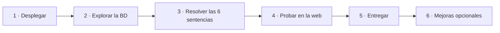
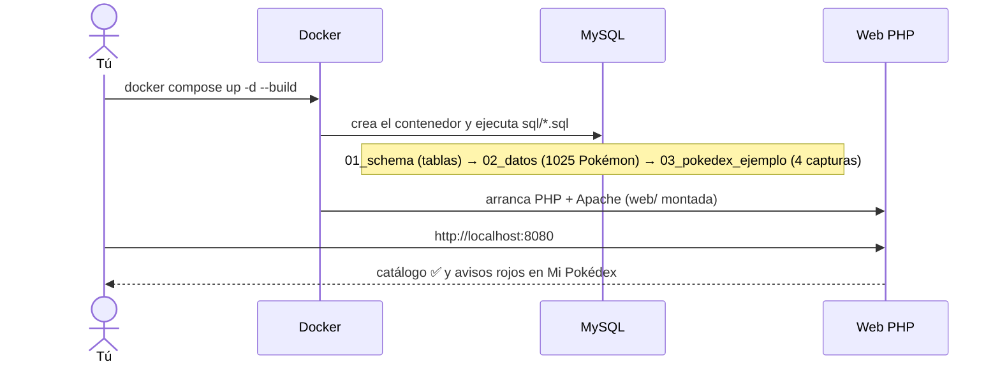
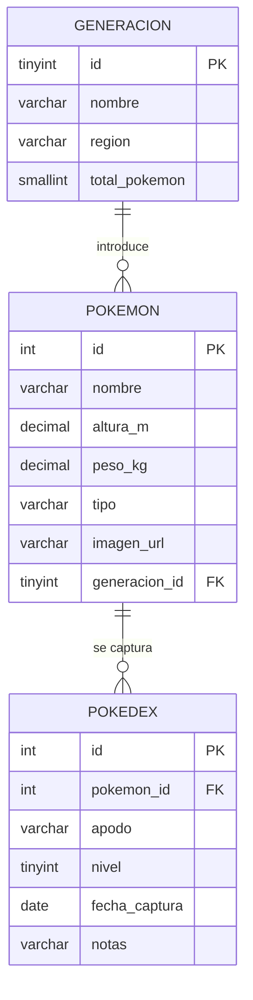
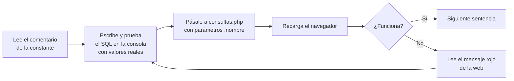

# EJERCICIO · Pokédex: CRUD con SQL

**Duración estimada:** 2 h · **Nivel:** SQL básico-intermedio (SELECT, JOIN, INSERT, UPDATE, DELETE, GROUP BY)

## 0. Qué vas a hacer

Tienes una aplicación web (PHP + MySQL) **ya construida** con un catálogo de 1025 Pokémon. Te faltan las
**6 sentencias SQL** que permiten gestionar tu **Pokédex personal** (los Pokémon que capturas).
Solo editarás un fichero: [`web/consultas.php`](web/consultas.php).



Qué aprenderás: JOIN de varias tablas · INSERT con `NULL` y clave foránea · UPDATE y DELETE con `WHERE` ·
agregados con `GROUP BY` · parámetros con nombre (consultas preparadas).

## 1. Requisitos

- Docker y Docker Compose (`docker --version`, `docker compose version`).
- Un editor de texto (VS Code, por ejemplo) y un navegador.
- Conexión a internet **no** es necesaria: las imágenes vienen incluidas.

## 2. Desplegar el proyecto



1. Descomprime el proyecto y abre una terminal **dentro de la carpeta `pokemon/`**.
2. Crea tu configuración y **cambia las dos contraseñas**:

   ```bash
   cp .env.example .env
   nano .env        # o edita .env con tu editor
   ```

3. Arranca todo:

   ```bash
   docker compose up -d --build
   ```

4. Comprueba que los dos contenedores están en marcha (`db` debe decir *healthy*):

   ```bash
   docker compose ps
   ```

5. Abre **http://localhost:8080**.

✅ **Resultado esperado**

| Página | Qué deberías ver |
|---|---|
| **Catálogo** | Tarjetas de Pokémon con imagen. El buscador y el filtro funcionan. |
| **Mi Pokédex** | Avisos rojos: «Falta escribir la sentencia SQL_LISTAR_POKEDEX…». ¡Es lo esperado! |

> Si algo falla, mira la sección *Problemas frecuentes* del [README](README.md#10-problemas-frecuentes)
> y `docker compose logs db web`.

## 3. Explora la base de datos

Entra en la consola de MySQL (te pedirá la contraseña `DB_PASSWORD` de tu `.env`):

```bash
docker compose exec db mysql -u pokemon -p pokemon
```



Calentamiento (ejecútalas y anota qué devuelve cada una):

```sql
DESCRIBE pokedex;
SELECT COUNT(*) FROM pokemon;
SELECT * FROM pokedex;
SELECT id, nombre, tipo FROM pokemon WHERE nombre LIKE 'pika%';
```

- **Pregunta 1:** ¿qué columnas de `pokedex` aceptan `NULL`? ¿Cuál tiene valor por defecto?
- **Pregunta 2:** ¿qué columna de `pokedex` es clave foránea y a qué tabla apunta?

## 4. Resuelve las 6 sentencias

Abre [`web/consultas.php`](web/consultas.php). Hay 3 ejemplos resueltos (catálogo) que puedes **leer y copiar
como modelo**, y 6 constantes vacías (`= '';`). **Método de trabajo para cada una:**



**Reglas:** usa **todos** los parámetros indicados y ninguno más · devuelve **exactamente** los nombres de
columna pedidos (alias con `AS`) · nunca concatenes valores en el SQL · el SQL de PHP va entre comillas
simples `'…'` o dobles `"…"`; puede ocupar varias líneas.

---

### Sentencia 1 · `SQL_LISTAR_POKEDEX` (READ, listado)

**Objetivo:** mostrar todas tus capturas con los datos del Pokémon y su generación. Aparece en **Mi Pokédex**.

| | |
|---|---|
| Parámetros | ninguno |
| Columnas | `id` (el de `pokedex`), `apodo`, `nivel`, `fecha_captura`, `notas`, `pokemon_id`, `nombre`, `tipo`, `imagen_url`, `altura_m`, `peso_kg`, `gen_nombre`, `region` |
| Orden | la captura más reciente primero (`fecha_captura` y, a igualdad, `id`) |

**Pista 1:** necesitas tres tablas: `pokedex` → `pokemon` (por `pokemon_id`) → `generacion` (por `generacion_id`).
**Pista 2:** `p.id AS pokemon_id` y `g.nombre AS gen_nombre`, porque hay columnas con el mismo nombre en varias tablas.

```sql
SELECT d.id, …
FROM pokedex d
JOIN pokemon p ON …
JOIN generacion g ON …
ORDER BY …
```

✅ **Comprueba:** en Mi Pokédex aparecen las 4 capturas de ejemplo, la de Snorlax primero.

---

### Sentencia 2 · `SQL_CAPTURAR_POKEMON` (CREATE)

**Objetivo:** guardar una captura nueva. Botón **Capturar** del catálogo.

| | |
|---|---|
| Parámetros | `:pokemon_id`, `:apodo`, `:nivel`, `:fecha_captura`, `:notas` |
| Nota | `id` es `AUTO_INCREMENT`: **no** lo incluyas |

**Pista:** `INSERT INTO pokedex (col1, col2, …) VALUES (:p1, :p2, …)`; el orden de columnas y valores debe coincidir.

✅ **Comprueba:** captura un Pokémon con apodo y otro **sin** apodo ni notas. Después, en la consola:

```sql
SELECT id, pokemon_id, apodo, notas FROM pokedex ORDER BY id DESC LIMIT 2;
```

**Pregunta 3:** en el que no escribiste apodo, ¿hay una cadena vacía `''` o `NULL`? ¿Dónde se decide eso (PHP o SQL)?

---

### Sentencia 3 · `SQL_OBTENER_POKEDEX` (READ, una fila)

**Objetivo:** cargar una captura para editarla. Botón **Editar**.

| | |
|---|---|
| Parámetros | `:id` (el de `pokedex`) |
| Columnas | `id`, `pokemon_id`, `apodo`, `nivel`, `fecha_captura`, `notas`, **`nombre`, `tipo`, `imagen_url`** (estas tres son del Pokémon) |

**Pista:** una sola captura (`WHERE d.id = :id`) con un `JOIN` a `pokemon` para traer nombre, tipo e imagen.

✅ **Comprueba:** *Editar* abre el formulario con el nombre, la imagen y los datos actuales.

---

### Sentencia 4 · `SQL_ACTUALIZAR_POKEDEX` (UPDATE)

**Objetivo:** cambiar apodo, nivel y notas de una captura. **Editar → Guardar**.

| | |
|---|---|
| Parámetros | `:id`, `:apodo`, `:nivel`, `:notas` |
| No se modifica | el Pokémon capturado ni la fecha |

**Pista:** `UPDATE pokedex SET … WHERE …`. ⚠️ **Sin `WHERE` cambiarías TODAS las filas.**

✅ **Comprueba:** cambia el nivel de Rayo y confirma en la consola que **solo** cambió esa fila:

```sql
SELECT id, apodo, nivel FROM pokedex;
```

---

### Sentencia 5 · `SQL_LIBERAR_POKEMON` (DELETE)

**Objetivo:** eliminar una captura. Botón **Liberar**.

| | |
|---|---|
| Parámetros | `:id` |

**Pista:** `DELETE FROM … WHERE …`. ⚠️ De nuevo, sin `WHERE` borrarías toda la tabla.

✅ **Comprueba:** libera una captura. Mi Pokédex tiene una menos y el Pokémon **sigue en el catálogo**:

```sql
SELECT COUNT(*) FROM pokemon;   -- siguen siendo 1025
```

---

### Sentencia 6 · `SQL_RESUMEN_POKEDEX` (agregados)

**Objetivo:** estadísticas por tipo. Aparecen como *chips* sobre tus capturas.

| | |
|---|---|
| Parámetros | ninguno |
| Columnas | `tipo`, `total` (nº de capturas), `nivel_medio` (media del nivel, **1 decimal**) |
| Orden | `total` de mayor a menor y, a igualdad, `tipo` |

**Pista:** `JOIN` con `pokemon` para conocer el tipo; `COUNT(*)`, `ROUND(AVG(d.nivel), 1)` y `GROUP BY p.tipo`.

✅ **Comprueba:** con las 4 capturas de ejemplo salen *Normal 2 · nivel medio 22.5*, *Electric 1 · 12.0*, *Fire 1 · 8.0*.

---

## 5. Prueba final

Con las 6 sentencias hechas, recorre este guion y marca cada punto:

| ✔ | Acción | Resultado esperado |
|---|---|---|
| ☐ | Abrir **Mi Pokédex** | 4 capturas, sin avisos rojos, estadísticas visibles |
| ☐ | Catálogo → buscar `char` → **Capturar** Charmeleon, nivel 16, apodo «Brasas» | Vuelve a Mi Pokédex con el aviso verde y la tarjeta nueva |
| ☐ | Capturar otro Pokémon **sin** apodo ni notas | Se muestra con su nombre; en la BD `apodo` es `NULL` |
| ☐ | **Editar** «Brasas»: nivel 17 y una nota | Cambia solo esa captura |
| ☐ | Intentar guardar nivel `101` | El navegador (`max=100`) y, si se salta, PHP lo rechazan |
| ☐ | **Liberar** una captura | Desaparece; el catálogo sigue con 1025 Pokémon |
| ☐ | Las estadísticas | Cambian al capturar y liberar |
| ☐ | Cambiar al tema oscuro (🌙) | Todo sigue legible |

## 6. Preguntas de comprensión

1. ¿Por qué se usan parámetros `:nombre` en vez de concatenar el valor dentro del SQL? ¿Qué ataque evitan?
2. ¿Qué pasaría si en la sentencia 4 olvidas el `WHERE`? ¿Y en la 5?
3. En la sentencia 6, ¿qué cambiaría si usaras `LEFT JOIN` desde `pokemon` en vez de `JOIN` desde `pokedex`?
4. Desde la consola, ejecuta `INSERT INTO pokedex (pokemon_id, nivel, fecha_captura) VALUES (99999, 5, CURDATE());`. ¿Qué error da y qué mecanismo lo provoca?
5. Prueba `DELETE FROM pokemon WHERE id = 25;`. ¿Se puede? ¿Por qué?
6. ¿Qué diferencia hay entre `apodo = ''` y `apodo IS NULL` al buscar capturas sin apodo?

## 7. Qué entregar

1. El fichero **`web/consultas.php`** con tus 6 sentencias.
2. Una **captura** de *Mi Pokédex* funcionando (con tus capturas nuevas).
3. Las **respuestas** a las preguntas 1-6.

| Criterio | Puntos |
|---|---|
| Sentencias 1 y 3 (JOIN) correctas y con los alias pedidos | 2 |
| Sentencia 2 (INSERT) correcta; `NULL` tratado bien | 2 |
| Sentencia 4 (UPDATE) con `WHERE` | 1,5 |
| Sentencia 5 (DELETE) con `WHERE` | 1,5 |
| Sentencia 6 (GROUP BY, COUNT, AVG, ROUND, orden) | 2 |
| Respuestas a las preguntas | 1 |
| **Total** | **10** |

---

## 8. Mejoras a incorporar

Cuando termines (o como proyecto de ampliación), elige una o varias. Dificultad: ★ fácil · ★★ media · ★★★ difícil · ★★★★ reto.
Antes de tocar el diseño lee [`DESIGN.md`](DESIGN.md): **se trabaja con tokens y componentes**, no con valores sueltos.

### 8.1 Mejoras de diseño

| # | Mejora | Qué se practica | Nivel |
|---|---|---|---|
| D1 | **Tema alternativo**: cambia la marca a azul redefiniendo solo `--color-marca`, `--color-marca-hover` y `--color-marca-texto` | Poder de los tokens: ningún componente cambia. Comprueba el contraste | ★ |
| D2 | **Filtro por tipo** con *chips* clicables en el catálogo (reutiliza `.chip` y `.estadistica`) | Componentes, `data-tipo`, JS | ★★ |
| D3 | **Diálogo de confirmación** con `<dialog>` en lugar de `confirm()` (nuevo componente `.dialogo`) | Crear un componente + documentarlo en `DESIGN.md` y en la guía | ★★ |
| D4 | **Esqueletos de carga** (*skeleton*) mientras llega la búsqueda | Animación con tokens de movimiento y `prefers-reduced-motion` | ★★ |
| D5 | **Avisos tipo *toast*** que desaparecen solos y se pueden cerrar con teclado | Accesibilidad (`role`, foco), JS | ★★ |
| D6 | **Animación de captura** (la pokéball de la marca gira o salta al capturar) | Movimiento con sentido, respeta `reduced-motion` | ★★ |
| D7 | **Auditoría Lighthouse** (accesibilidad ≥ 95): corrige lo que detecte y anota los cambios | Herramienta de auditoría; el proyecto *no* se ha auditado con ella | ★★ |
| D8 | **Página de error 404 / 500** con el sistema de diseño (componente `.vacio`) | Reutilización, configuración de Apache | ★★ |
| D9 | **Vista de lista/tabla** alternativa a las tarjetas para Mi Pokédex | Nuevo componente, responsive | ★★★ |

### 8.2 Mejoras técnicas (lo que hoy nos falta)

| # | Mejora | Por qué hace falta | Nivel |
|---|---|---|---|
| T1 | **`CHECK (nivel BETWEEN 1 AND 100)`** en `pokedex` | Hoy solo valida PHP: desde la consola se puede insertar nivel 200. La BD debe defender sus datos | ★ |
| T2 | **Paginación** (`LIMIT`/`OFFSET`) en el catálogo | Con «Todas las generaciones» solo se muestran 200 de los 1025 Pokémon (`LIMIT 200`) | ★★ |
| T3 | **Índice y `EXPLAIN`**: comprueba si `LIKE '%pika%'` usa `idx_pokemon_nombre` y prueba `LIKE 'pika%'` | Entender cuándo un índice ayuda y cuándo no | ★★ |
| T4 | **Vista SQL `v_pokedex`** con el JOIN de la sentencia 1 | Reutilizar y simplificar consultas | ★★ |
| T5 | **Límite de 6 Pokémon en el «equipo»** (`ALTER TABLE` + columna `equipo` + regla en PHP/SQL) | Restricciones de negocio, `COUNT` antes de `UPDATE` | ★★★ |
| T6 | **Transacciones**: capturar varios Pokémon a la vez o todo o nada | `beginTransaction`, `commit`, `rollBack` | ★★★ |
| T7 | **API JSON completa** de la Pokédex (`GET/POST/PUT/DELETE`) y consumirla con `fetch` | Separación backend/frontend, códigos HTTP | ★★★ |
| T8 | **Tests automáticos** (script `curl` o PHPUnit) que verifiquen las 6 sentencias | Hoy todo se prueba a mano | ★★★ |
| T9 | **Cabeceras de seguridad** (`Content-Security-Policy`, `X-Content-Type-Options`) y cookie de sesión `HttpOnly` + `SameSite` | Endurecer la aplicación | ★★ |
| T10 | **Imágenes aún más ligeras**: hoy son PNG de 300 px (~24 MB en total); prueba WebP/AVIF y `srcset` | Rendimiento, formatos de imagen | ★★ |
| T11 | **Copia de seguridad** con `mysqldump` y restauración | Operación de la BD | ★ |
| T12 | **Healthcheck de la web** y registro de errores SQL | Observabilidad | ★★ |
| T13 | **Entrenadores y login**: tabla `entrenador`, `password_hash`, cada uno su Pokédex | Relación 1:N, autenticación, sesiones | ★★★★ |
| T14 | **Migraciones versionadas** (`V1__…sql`, `V2__…sql`) en lugar de editar `01_schema.sql` | Evolución del esquema sin perder datos | ★★★ |

> Para cada mejora: describe **qué cambiaste, por qué, y cómo lo probaste**. Si es de diseño, actualiza `DESIGN.md`
> y la [guía de estilos](web/guia-estilos.html); si es técnica, actualiza el `README.md` (y su diagrama si cambia el modelo).
